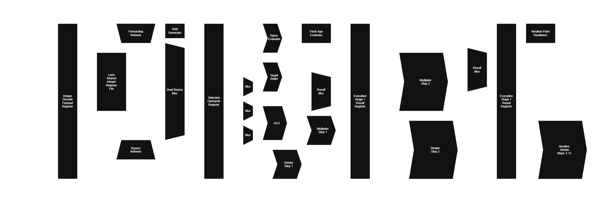

## Lane Model
Anvil-Core opts for a highly parameterizable backend, the crux of which being the concept of heterogenous "lane" instantiation at compile time.

## Memory Lanes
The issuer assigs the earliest index memory is possible to be caught in if possible. Global stalls hit if operand is not ready. AXI type bus with response bus tag matches and checks result into arbitrary memory stage where the placeholder exists. same cycle it latches ready bit and is available for forawrds next cycle. This maintains order and allows memory to pipeline effectively until an operand is needed.

## notes
perhaps multi duplicated bram reg file. os only needs to read and latch use reg file bit .
may also need per fetch word ready bits from cache to work with raw line cache architectures
also likely put in a ras
also gshare predictor

## Integer Lanes

## Multiplier Design
The current implementation uses a pipelined radix-2 carry-save partial Wallace tree multiplier. Radix-2 refers to the number of operand bits corresponding to a generated partial product. A radix-4 partial product constructor would generate a partial product for every 2 bits, while radix-2 generates a partial product every 1 bit. Carry-save refers to the method by which partial products are reduced to lower carry propagation. A carry-save multiplier uses the identity ``X + Y + Z`` = ``S + C``, where S is ``X ⊕ Y ⊕ X`` and C is the carry vector. Done over every set of 3 partial products, this method reduces the product list in parallel by a factor of 1.5. This allows carry dependencies otherwise evaluated in rippling fashion to be calculated in smaller, parallel batches. A Wallace tree refers to the reptation of a reduction operation (such as carry-save) until the product is the sum of 2 remaining vectors. While similar in concept, this design does not use a full Wallace tree, rather opting for reduction until 4 vectors remain. 

The final configuration was arrived at empirically through evaluating several parameters and architecture variants. Notably, the additional routing and selection logic associated with radix-4 lost on timing compared to every tested radix-2 configuration. Additionally, the reduction to 2 vectors traditionally used by a Wallace tree lost to a 4-vector reduction. This is likely because FPGAs have quite efficient adders in comparison to general logic. The logic from the extra reduction tree nodes created sufficient routing, congestion, and LUT delay to be greater than the time saved by the reduced carry chain. The final configuration best distributed the critical path over the reduction/product generation stage and the addition stage, closing at 231.4MHz. More or less compression stages distributed critical path less evenly, thus performing worse post synthesis. 

| Radix | Compressions | Final Vectors | Fmax | Period | LUTs | FFs |
|---|---|---|---|---|---|---|
| Radix-2 | 8 | 2 | 169.5 MHz | 5.900 ns | 1,639 | 219 |
| Radix-2 | 7 | 3 | 182.0 MHz | 5.496 ns | 1,637 | 252 |
| **Radix-2** | **6** | **4** | **231.4 MHz** | **4.321 ns** | **1,552** | **285** |
| Radix-2 | 5 | 6 | 188.4 MHz | 5.308 ns | 1,549 | 348 |

To handle signedness and RISC-V specific writeback needs, 3 compensation vectors are injected into the initial partial product pool. They are compressed by the partial Wallace tree like other vectors and are not treated differently. The compensation vectors are either 0 or a bitwise inversion of the 2 initial input operands. The third vector consists of the remaining ones that need to be added to the inverted compensation vectors to form a 2's compliment result. In total, the full pool of vectors consists of 32 shift-derived partial products and 3 signedness compensation vectors. 

## Divider Design
The divider implementation, kindly one-shotted by GPT-6 Astra, uses an "auto-pipelined" radix-2^x restorative division algorithm with parallel trial subtraction. Radix, similar to the multiplier, specifies the number of operand bits corresponding to a generated division step. Restorative refers to a section of the algorithm where the new remainder (the main chaining dependency) is calculated. A restoring implementation discards a subtraction result if it is negative, retaining the previous shifted remainder, while a non-restoring implementation retains the negative result and compensates for it by adding the divisor during the next iteration instead of subtracting it. 

The design is "auto-pipelined", referring to its parameterizable pipeline distribution. A top-level parameter at compile time decides where in the overall combinational cycle to inject registers. This serves three purposes: First, it helps in development by allowing for less manual rewriting of RTL while arriving at an optimally timed result. Second, it can be used during compile time depending on the desired configuration to insert more or less stages based on how aggressive the frequency requirements are. For example, a divider in a dual-issue configuration may only need to meet 200 MHz, thus allowing for total pipeline register count and cycle latency to be reduced in comparison to, say, a 260 MHz single-issue configuration. Third, it allows for advanced users to manually adjust the pipelining requirements at compile time to accomplish individual goals, custom requirements, or hardware specific optimizations. Together, these factors make a strong case for auto-pipelining implementations of any module when possible in highly configurable designs. Stage Formula: ``STAGES = ((32 + AUTO_PIPE - 1) / AUTO_PIPE) + 2`` Radix Formula: ``RADIX = 2^AUTO_PIPE``

There is no clear winner for which configuration is optimal for Anvil-Core. This would depend on target frequency as well as division instruction frequency. The radix-4 implementation achieves a higher fmax, albeit at the cost of additional divider latency and thus pipeline stalling. The radix-8 implementation, while slower, is typically still above target frequency for Anvil-Core. Thus, the relatively slower frequency does not become part of the overall critical path. This takes frequency out of the equation of most optimal implementation, and thus only the quantity of stages and utilization needs to be considered. The default configuration uses Radix-8 on the premise that it provides strictly better IPC. However, it may be easily swapped for radix-8 on more constrained systems. 

Below are synthesis numbers for several selected configurations:

| Radix | Stages | Fmax | Period | LUTs | FFs |
|---|---|---|---|---|---|
| Radix-4 | 18 | 246.9 MHz | 4.050 ns | 1,863 | 1,477 |
| Radix-8 | 13 | 220.3 MHz | 4.540 ns | 2,826 | 2,090 |
| Radix-16 | 10 | 201.4 MHz | 4.966 ns | 4,627 | 3,526 |
