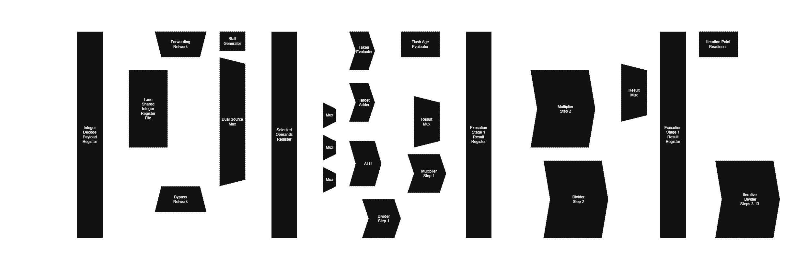

## Lane Model

See the [CPU stall and redirect protocol](Core/STALL_AND_REDIRECT.md) for stage-by-stage backpressure, branch recovery timing, and producer ownership across a flush.

Anvil-Core opts for a highly parameterizable backend, the crux of which being the concept of heterogenous "lane" instantiation at compile time. Long story short:
FP lanes only forward to other FP lanes, they dynamically search for operands. No integer forwarding goes to them nor integer outputs come from them.
Integer and memory lanes are served static tags to fetch operands from at issue time. Memory lanes broadcast ready bits, integer lanes are guarenteed ready.
The single serial lane (lane 0) is lockstep and stalls like every other lane. It has no forwarding in or out, so its consumers and its own sources use the register file. It reads rs1 through its own RF read port. CSRRW/CSRRS/CSRRC and the immediate forms read the old value at the final slot and write on the retiring edge. Implemented CSRs:
- mstatus: only MIE and MPIE are stored; MPP reads as M, FS reads 0.
- mie and mip: only MSI, MTI and MEI (bits 3, 7, 11). mip is read-only to software; CoreTop's `interrupt`/`interrupt_type` pulses set its bits, and taking the interrupt clears the bit.
- mtvec: direct mode only. mepc: bit 0 reads 0.
- mcause: standard codes. A bus error is reported as misaligned load/store (4/6) when the access was misaligned, otherwise load/store access fault (5/7).
- misa: a read-only constant derived from the SUPPORT_* parameters (MXL=1, plus I, C, M, and A/F when enabled).
- mscratch is writable. FS is fixed Off in all configurations. FP instructions and FP CSR accesses raise ILLEGAL, and FP CSRs require no storage.

Interrupts: the serial lane presents the highest-priority pending and enabled interrupt (`mip & mie & mstatus.MIE`; priority MEI, MSI, MTI) to Decode. Decode tags the oldest valid served instruction with it, which travels through the serial lane. Decode stops admitting younger instructions after a known trap or MRET until recovery. No decode hold follows a write to mie or mstatus: if an older write disables an interrupt after tagging, trap entry's re-check refetches the instruction. Trap entry selects the highest-priority source still enabled and pending. Trap entry and MRET run one cycle after the writeback trap, from per-writer trap skid buffers in BackendTop. That cycle writes mepc/mcause/mstatus/mip and drives the frontend redirect PC from flops: mtvec for a trap, mepc for MRET, or the instruction's own PC when no interrupt remains enabled and pending (refetch, no CSR change). MRET flushes at writeback like a trap but retires. mcycle/mcycleh and minstret/minstreth are spec 64-bit counters, with read-only cycle/cycleh/instret/instreth aliases. minstret counts the instructions retiring at writeback. Fetch predecodes a CSR whitelist: nonexistent CSRs and writes to read-only addresses raise `ILLEGAL`. FENCE.I flushes at writeback, retires, and refetches PC + 4. FENCE drains the same way (it orders time reads and other CSR effects against younger memory accesses); WFI is a no-op. The serial lane handles every trap discovered before issue.

## Memory Lanes
Memory operations, in particular loads, must be handled differently than most other instructions due to their variable latency nature. Given that the pipeline design is strictly in order, an instruction dependent on load data MUST stall itself and everything younger to prevent correctness issues. There is no replay mechanism to otherwise repair an instruction if it were to continue past its operand selection stage missing its dependency data. Additionally, even in the case where a load does not have any immediate dependencies on its result, it still must stall the pipeline to maintain in-order semantics before it commits to the register file. No younger instruction may commit to the register file until the load has completed and commit entirely. Without this, unintentional WAW among other correctness issues are possible, corrupting the register file state and breaking flush recovery. Given these invariants, the memory architecture must satisfy them in a way that preserves correctness while also minimizing backend stall cycles.

The following design was arrived at, meeting the intended goals outlined above. Memory lanes consist of two blocks, the lane itself and the LSU. Memory lanes are unrolled like other lanes by EXECUTION_UNROLL, and stall globally under the same conditions other lanes do. A "lane" serves to maintain pipeline ordering, serve as a forwarding reference to other lanes and itself, pass forward results, and check into the register file. A single LSU sits above all memory lanes, to which they check desired operations into. The LSU arbitrates in the case of multiple memory lanes and maintains age ordering over its single bus. The LSU receives results from the response bus and checks them back into the corresponding memory lane slots that issued the request. Importantly, the LSU maintains a concept of pipeline motion, and thus the pipeline may step forward while memory operations are pending. The LSU maintains the index of the outgoing instruction and checks it into the lane index adjusted for pipeline motion. This serves as a sort of "pass and catch" mechanism, where the instructions "pass" to the LSU, flow forward without causing stalls while waiting, and "catch" the result at a later index, avoiding stalls in the ideal case. However, as painfully obvious in CPU architecture, the ideal case is not the only case. 

Stalls are still possible in several scenarios. Primarily, stalls will occur on load use dependencies. If a younger instruction is dependent on a load, it is still considered valid by the issuer regardless of the status of the load data. However, once in the operand selection stage of the backend, the pipeline will stall if the load data is not ready. This means the memory lane will freeze and the load instruction will maintain its lane and index. Similar to the iterating units present on integer lanes, the operand selection stage looks at a ready bit from its dependency index of the memory lane. This bit is indistinguishable from the one used by iterating units to dictate operand readiness. A useful analogy is that every stage of a memory lane is an iterating unit. The LSU continues to await a response and process instructions while the pipeline is stalled, and continues to check them into lane slots as results appear. 

The other possibility of a stall is a memory operation reaching the iteration point without a valid result. In this case, the pipeline will globally stall until the LSU checks in a result. This maintains ordering, which is a primary correctness concern.


BackendTop connects the issuer packet arrays to the configured integer and memory lanes and their shared integer file. LoadStoreUnit queues one request per registered memory forwarding point per lane. On pipeline advance it appends the AGU candidates in issue-age order, before the same-cycle redirect squash is known. Candidates killed by that redirect are counted into a registered squash count, never sent, and retracted from the tail on the next edge; they are always the youngest entries. Its 32-bit bus can issue one request per cycle and requires one response per load or store, strictly in request order. The bus peer must discard outstanding transfers on reset. The LSU keeps the owner until the response handshake. That lane captures the result in its oldest unfinished slot, including during a stall. Consumers forward from the registered slot on the following cycle. System (Core/SystemTop.sv): CoreTop plus a data-side Crossbar, a small CLINT and RAM, all in Core/Peripherals.
- Address map: the CLINT occupies [0, 0x100) and a register-only UART occupies [0x100, `RAM_BASE` = 0x200). RAM spans [0x200, `MAX_MEMORY_ADDRESS`].
- UART registers (word offsets, low byte used): TX_DATA 0x00 (write-only byte buffer), TX_BUSY 0x04 (read-only, tied low), RX_DATA 0x08 (read-only byte buffer), RX_READY 0x0C (read-only, registered, cleared by reading RX_DATA). There is no serial hardware yet, so nothing sets RX_READY or loads RX_DATA.
- Above that range, and for misaligned accesses, the crossbar returns `response_error`.
- `RESET_VECTOR` = `RAM_BASE`.
- Instructions and data share the RAM. CoreTop exports a fetch port (`fetch_request`/`fetch_address` out, `fetch_data`/`fetch_valid` in, one-cycle response), and the Crossbar arbitrates it with the data bus, data first.
- The RAM is word-interleaved into 4 single-port banks (the next power of two at or above the 3-word fetch window), so a fetch loses only when the data access hits one of the banks it needs. A denied fetch returns `fetch_valid = 0` and Fetch re-requests.
- Fetch words outside the RAM read zero, which decodes as ILLEGAL.
- SystemTop's `HEX_FILE` loads the RAM; its word 0 is 0x200.
- The frontend's InstructionMemory is no longer instantiated; tests that used it via FetchTop need a memory model.
- CLINT registers use ACLINT semantics at compacted offsets: msip 0x00, mtimecmp 0x08/0x0C, mtime 0x10/0x14.
- mtimecmp resets to all ones, so the timer cannot fire until it is programmed.
- mtime feeds the time/timeh CSRs.
- The CLINT timer and software levels drive mip.MTIP and mip.MSIP directly, so they follow spec level semantics: they stay pending until software writes mtimecmp or msip, and trap entry does not clear them. A rising edge of `external_interrupt` becomes an INT_EXTERNAL pulse that sets the sticky mip.MEIP, which trap entry clears.

Every memory trap is discovered by the bus. Requests carry the full byte address and `request_size`, and the bus must answer misaligned, out-of-range (above `MAX_MEMORY_ADDRESS`) and failed accesses with `response_error`. Nothing traps in a memory lane before the bus. The memory lane classifies the error at writeback from its own size and offset (misaligned load/store, else load/store access fault), and the error locks the LSU. While locked, younger entries complete locally with garbage until the writeback `trap` flushes the LSU and blocks check-ins for 3 cycles. See the [stall and redirect protocol](Core/STALL_AND_REDIRECT.md). `Parameters::PRECISE_BUS_FAULTS` (default 1) makes a store wait for all older bus responses, so bus faults are precise. With 0, the store gate is always open and a store may overtake an older load's error. Each writeback port corresponds to one original issue slot, selected by the registered instruction age. The writeback trap clears every backend valid bit, and the skid cycle recovers the frontend to the trap target.

## Integer Lanes


## Multiplier Design
The current implementation uses a pipelined radix-2 carry-save partial Wallace tree multiplier. Radix-2 refers to the number of operand bits corresponding to a generated partial product. A radix-4 partial product constructor would generate a partial product for every 2 bits, while radix-2 generates a partial product every 1 bit. Carry-save refers to the method by which partial products are reduced to lower carry propagation. A carry-save multiplier uses the identity ``X + Y + Z`` = ``S + C``, where S is ``X ⊕ Y ⊕ X`` and C is the carry vector. Done over every set of 3 partial products, this method reduces the product list in parallel by a factor of 1.5. This allows carry dependencies otherwise evaluated in rippling fashion to be calculated in smaller, parallel batches. A Wallace tree refers to the reptation of a reduction operation (such as carry-save) until the product is the sum of 2 remaining vectors. While similar in concept, this design does not use a full Wallace tree, rather opting for reduction until 4 vectors remain. 

The final configuration was arrived at empirically through evaluating several parameters and architecture variants. Notably, the additional routing and selection logic associated with radix-4 lost on timing compared to every tested radix-2 configuration. Additionally, the reduction to 2 vectors traditionally used by a Wallace tree lost to a 4-vector reduction. This is likely because FPGAs have quite efficient adders in comparison to general logic. The logic from the extra reduction tree nodes created sufficient routing, congestion, and LUT delay to be greater than the time saved by the reduced carry chain. The final configuration best distributed the critical path over the reduction/product generation stage and the addition stage, closing at 231.4MHz. More or less compression stages distributed critical path less evenly, thus performing worse post synthesis. 

Note: The design has moved compressions around a bit since these were run.

| Radix | Compressions | Final Vectors | Fmax | Period | LUTs | FFs |
|---|---|---|---|---|---|---|
| Radix-2 | 8 | 2 | 169.5 MHz | 5.900 ns | 1,639 | 219 |
| Radix-2 | 7 | 3 | 182.0 MHz | 5.496 ns | 1,637 | 252 |
| **Radix-2** | **6** | **4** | **231.4 MHz** | **4.321 ns** | **1,552** | **285** |
| Radix-2 | 5 | 6 | 188.4 MHz | 5.308 ns | 1,549 | 348 |

In-core note (2026-11-22, revised 2026-11-23): inside CoreTop at 5 ns, step 1 now stops after 4 compressions and registers 8 vectors; the fifth and sixth compressions (8 to 6 to 4) run ahead of the final adder in step 2. The table above is the standalone study and is unchanged.

To handle signedness and RISC-V specific writeback needs, 3 compensation vectors are injected into the initial partial product pool. They are compressed by the partial Wallace tree like other vectors and are not treated differently. The compensation vectors are either 0 or a bitwise inversion of the 2 initial input operands. The third vector consists of the remaining ones that need to be added to the inverted compensation vectors to form a 2's compliment result. In total, the full pool of vectors consists of 32 shift-derived partial products and 3 signedness compensation vectors. 

## Divider Design
(needs update, design has now changed)
The divider implementation, kindly one-shotted by GPT-6 Astra, uses an "auto-pipelined" radix-2^x restorative division algorithm with parallel trial subtraction. Radix, similar to the multiplier, specifies the number of operand bits corresponding to a generated division step. Restorative refers to a section of the algorithm where the new remainder (the main chaining dependency) is calculated. A restoring implementation discards a subtraction result if it is negative, retaining the previous shifted remainder, while a non-restoring implementation retains the negative result and compensates for it by adding the divisor during the next iteration instead of subtracting it. 

The design is "auto-pipelined", referring to its parameterizable pipeline distribution. A top-level parameter at compile time decides where in the overall combinational cycle to inject registers. This serves three purposes: First, it helps in development by allowing for less manual rewriting of RTL while arriving at an optimally timed result. Second, it can be used during compile time depending on the desired configuration to insert more or less stages based on how aggressive the frequency requirements are. For example, a divider in a dual-issue configuration may only need to meet 200 MHz, thus allowing for total pipeline register count and cycle latency to be reduced in comparison to, say, a 260 MHz single-issue configuration. Third, it allows for advanced users to manually adjust the pipelining requirements at compile time to accomplish individual goals, custom requirements, or hardware specific optimizations. Together, these factors make a strong case for auto-pipelining implementations of any module when possible in highly configurable designs. Stage Formula: ``STAGES = ((32 + AUTO_PIPE - 1) / AUTO_PIPE) + 2`` Radix Formula: ``RADIX = 2^AUTO_PIPE``

There is no clear winner for which configuration is optimal for Anvil-Core. This would depend on target frequency as well as division instruction frequency. The radix-4 implementation achieves a higher fmax, albeit at the cost of additional divider latency and thus pipeline stalling. The radix-8 implementation, while slower, is typically still above target frequency for Anvil-Core. Thus, the relatively slower frequency does not become part of the overall critical path. This takes frequency out of the equation of most optimal implementation, and thus only the quantity of stages and utilization needs to be considered. The default configuration uses Radix-8 on the premise that it provides strictly better IPC. However, it may be easily swapped for radix-8 on more constrained systems. 

Below are synthesis numbers for several selected configurations:

| Radix | Stages | Fmax | Period | LUTs | FFs |
|---|---|---|---|---|---|
| Radix-4 | 18 | 246.9 MHz | 4.050 ns | 1,863 | 1,477 |
| Radix-8 | 13 | 220.3 MHz | 4.540 ns | 2,826 | 2,090 |
| Radix-16 | 10 | 201.4 MHz | 4.966 ns | 4,627 | 3,526 |


## Frontend timing across parameter sets

Implementation note: from 2026-11-22, Synthesis/Scripts flows run `phys_opt_design -directive AggressiveFanoutOpt` after placement. Runs before that date used opt/place/route only. Treat later frontend runs as a separate series from the rows below.

Note: These numbers are out of context and representative, not authoritative

```bash
create_clock -name frontend_clk -period 2.500 [get_ports clk]
set late_controls [get_ports {stall redirect_taken redirect_pc[*]}]
set_input_delay -clock frontend_clk -max 3.250 $late_controls # Dual Issue
set_input_delay -clock frontend_clk -max 2.500 $late_controls # Single Issue
set_input_delay -clock frontend_clk -min 2.000 $late_controls
set_input_delay -clock frontend_clk -max 1.000 [get_ports {reset serial_active}]
set_input_delay -clock frontend_clk -min 1.000 [get_ports reset]
set_input_delay -clock frontend_clk -min 0.500 [get_ports serial_active]
set_output_delay -clock frontend_clk -max 0.000 [all_outputs]
set_output_delay -clock frontend_clk -min 0.000 [all_outputs]
```

| ISA | Issue Width | FIFO Words | Cache Line Words | Lanes | Frequency (MHz) | Period (ns) | LUTs | FFs |
|---|---|---|---|---|---|---|---|---|
| RV32IMAFC | 2 | 8 | 2 | 5 | 226.96 | 4.406 | 5,337 | 2,276 |
| RV32IMC | 2 | 8 | 2 | 4 | 231.00 | 4.329 | 4,721 | 2,025 |
| RV32IC | 2 | 8 | 2 | 4 | 223.76 | 4.469 | 4,737 | 2,019 |
| RV32IMAFC | 1 | 8 | 1 | 4 | 274.65 | 3.641 | 2,045 | 1,427 |
| RV32IMC | 1 | 8 | 1 | 3 | 283.61 | 3.526 | 1,831 | 1,314 |
| RV32IC | 1 | 8 | 1 | 3 | 279.25 | 3.581 | 1,821 | 1,310 |

## Frontend TODOs

- Detect sequential PC wrap, including compressed and split instructions. Define fault reporting and recovery.
- Handle registered prediction_result[i].bp_target_wrapped for taken predictions, preserving instruction association.
- Impliment RAS


## Additional implementation TODOs

- [ ] Implement FP dependencies, including rs3 and lane operand search.
- [ ] Extend integer memory execution with atomics and floating-point loads/stores.
- [ ] Decide on mtval contents and vectored mtvec.
- [ ] Implement FloatingLane arithmetic, conversions, rounding, exceptions and result delivery.
- [ ] Remaining SerialLane work: a writable mstatus.FS with fcsr/fflags/frm (aliased) once FP lanes exist, mtval contents.
- [ ] Decide whether `serial_active` (tied low in CoreTop) is still needed.
- [ ] Support issue widths above two if required.

FP load forwarding policy is prepared as Parameters.FP_LOAD_RF_ONLY, default 0.
Implement its enforcement with FloatingLane operand search: 0 permits searching
memory lanes and 1 requires the youngest matching FP load owner to reach RF.
Apply the policy to every FP source, including rs3, using the existing capture
threshold index >= EXECUTION_UNROLL+1. The current lane shell does not enforce it.
