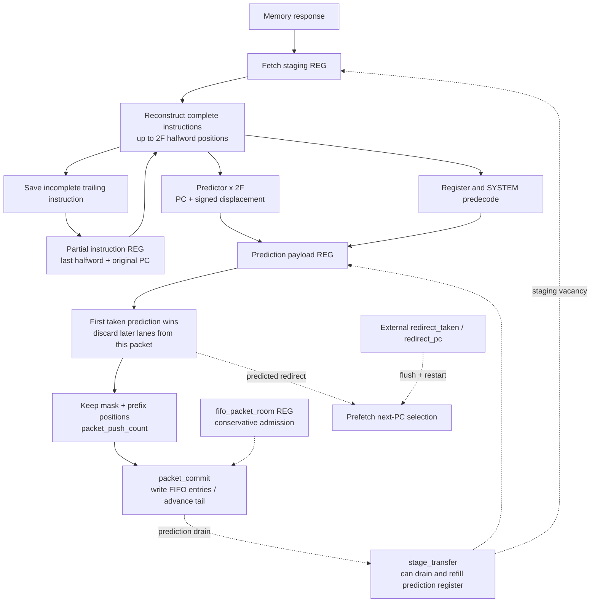
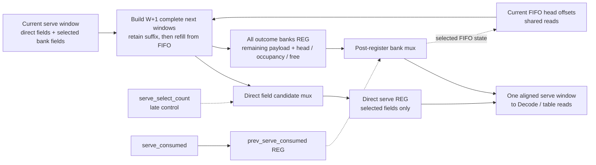
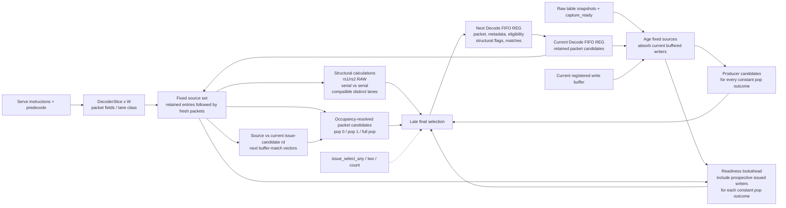
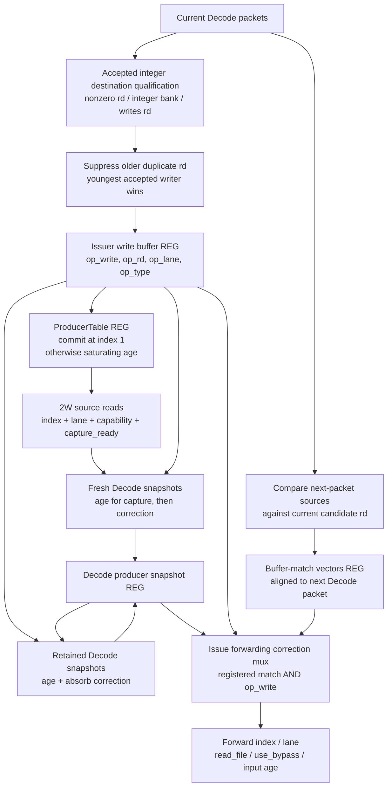
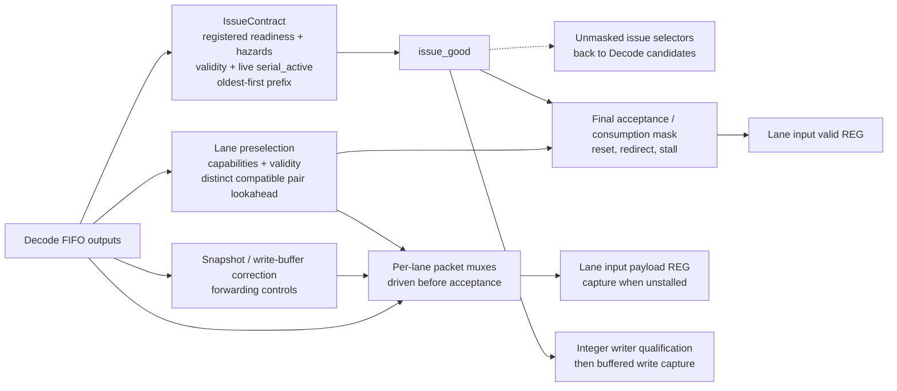
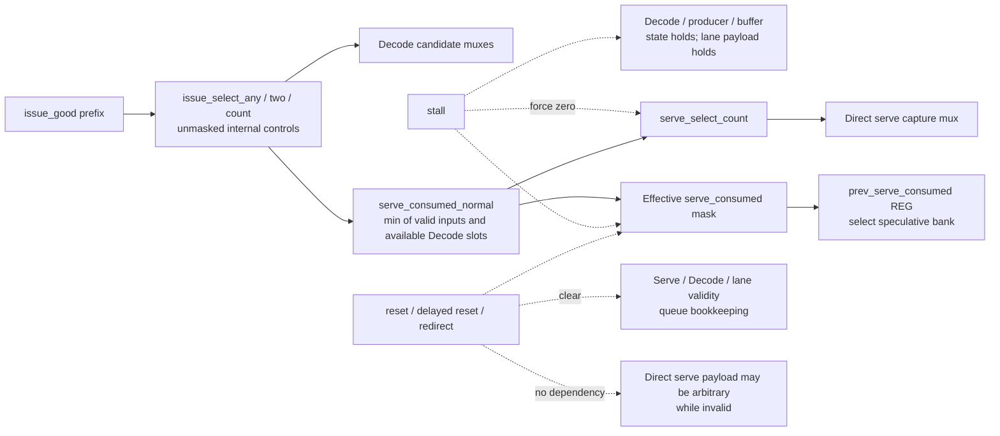

# Frontend — diagram source and mechanism map

Snapshot: 2026-11-17. A communication draft for drawing the final frontend schematic, based on the current RTL rather than every historical experiment. Read the views together: no single diagram below implies an extra pipeline register unless the box explicitly says **REG** or **FIFO**.

Notation: solid arrows carry payload or state; dotted arrows carry control. W = ISSUE_WIDTH (implemented allocator supports 1 or 2), F = FETCH_WORDS, U = EXECUTION_UNROLL. Rectangular REG boxes are clock boundaries; other boxes are combinational. “Speculative” below means preparing queue-consumption outcomes, not issuing an instruction speculatively.

## 1. Whole frontend and its clock boundaries

```mermaid
flowchart LR
  PC["Fetch address / response tracking REG"] --> IM["InstructionMemory
synchronous read + alignment REG"]
  IM --> ST["Fetch staging REG
words, PC, error, boundaries"]
  ST --> RE["Instruction reconstruction
16/32-bit + split-word recovery"]
  PART["Partial halfword + PC REG"] --> RE
  RE --> PR["Static branch prediction
direct jumps taken
backward conditional branches taken"]
  RE --> RS["RegisterSlice
rs1 / rs2 / rs3 / rd
banks, use bits, capability"]
  RE --> SYS["SystemTrapPredecode
SYSTEM / CSR checks"]
  PR --> PP["Prediction REG
payload + direction + target
register metadata + system trap"]
  RS --> PP
  SYS --> PP
  PP --> KEEP["Keep through first taken prediction
compact surviving instructions"]
  PP --> PD["Remaining legality
low immediate / upper layout
branch operation / FP consumer"]
  KEEP --> FIFO["Instruction FIFO
FIFO_WORDS entries"]
  PD --> FIFO
  KEEP -. predicted target .-> PC
  FIFO --> SV["Serve window
direct registers + speculative banks
W instructions"]
  SV --> DEC["DecoderSlice x W
independent field construction"]
  SV --> PT["Dispatch ProducerTable
32 integer mappings + ready bits"]
  DEC --> DQ["Decode FIFO REG
packet + producer snapshots
ready + hazards + buffer matches"]
  PT --> DQ
  DQ --> ISS["IssueContract + lane preselection
forwarding packet construction"]
  ISS --> LR["Per-lane input REG model
serial / integer / memory / FP"]
  ISS --> WB["One advancing-cycle
integer write buffer REG"]
  WB --> PT
  WB --> DQ
  WB --> ISS
  ISS -. issue_select_any / two / count .-> DQ
  DQ -. serve_select_count / serve_consumed .-> SV
```

**Ownership:** ProducerTable remains in Dispatch. Fetch supplies addresses; Decode reads the table and holds snapshots; Issue publishes producers. Synthesis hierarchy names can cross these boundaries through optimization and are not a reliable ownership diagram.

The frontend top's per-lane registers model which payload fields real lanes consume, allowing pruning. They are not the complete execution pipeline. The actual IntegerLane has its own operand selection, forwarding, execution and iteration machinery (see IntegerLane.png).

## 2. Fetch admission, prediction and partial instructions

FIFO admission deliberately does **not** rely on current-cycle serve pulls for room. This cuts the long backward path from Issue through Decode and Fetch into admission. FIFO refill sees entries already present before the edge; a simultaneous FIFO push is not a fall-through read. External redirect invalidates the wrong-path stream; predicted taken selection retains the branch itself and suppresses later packet lanes.

InstructionMemory payload/alignment registers do not need reset; response validity handles reset. Predictor is combinational despite having clock/reset ports. Queue owns its capture registers.

## 3. Serve window: two mechanisms, one instruction order

| Field | Serve implementation now | Why it is placed there |
|---|---|---|
| Instruction 32 + compressed 1 | Direct capture | Decode starts from a register, not the bank mux |
| rs1/rs2 identities + bank flags, 12 bits | Direct capture | Producer read addresses arrive early |
| rd identity + bank flag, 6 bits | Direct capture | Same-group RAW comparison arrives early |
| Capability, enum width | Direct capture | Structural/resource checks avoid bank selection |
| Trap, enum width | Direct capture | Carried legality does not wait on the bank |
| FP-consumer, 1 bit | Direct capture; tied low without F | RF-only integer-source qualification arrives early |
| Valid, 1 bit | Direct capture with explicit flush clearing | Early valid prefix and candidate qualification |
| PC, taken and branch flags | Banked | Preserve late-control isolation for wider payload |
| Low immediate, 5 bits | Banked | Already computed before FIFO insertion |
| Upper-immediate layout enables, 14 bits | Banked | Direct capture was reverted to reduce late-pop loading |
| Branch operation | Banked | Predecoded before FIFO insertion |
| rs3 + bank; rs1-used / rs2-used / rd-written | Banked | Remaining carried metadata |
| FIFO head / occupied / free | Banked | Compute all pop consequences before late count |

All field candidates use the **same next_window mapping**. This is not a second queue with independent popping. Unused stored copies of directly captured fields have no consumers and can prune.

Example, full dual-issue serve window `[A,B]`, existing FIFO `[C,D,...]`:

| Consumption | Candidate next window | FIFO pulls |
|---|---|---|
| 0 | A, B | 0 |
| 1 | B, C | 1 |
| 2 | C, D | 2 |

With only `[A]` valid, outcome 0 can fill the vacant slot with C. Single issue builds two outcomes, 0 and 1; dual issue builds three. Before the edge, the direct mux chooses the real outcome. At the edge, direct fields and the bank selector capture together. After the edge, the selected bank supplies the matching remaining fields.

## 4. Decode: compute alternatives early, select late

**No bank of full decoded candidate packets is registered.** Decode builds combinational candidates and captures just the chosen packet. For dual issue, `issue_select_any` selects pop 0 versus pop 1; `issue_select_two` overrides with the full-pop fresh packet. Producer and one-bit lookahead outcomes are similarly prepared before the count selection.

Each Decode slot carries:

| Registered information | Meaning / consumer |
|---|---|
| DecoderPacket + lane type + validity | Execution controls and lane selection |
| Retained encoding-use bits | Structural comparisons, including allowed false hazards on illegal encodings |
| rs1/rs2 index, lane, capability | Snapshot of producer identity/progress for forwarding |
| operands_ready | Eligibility for the cycle after capture |
| group_raw | Dependency on an older instruction in this issue group |
| group_serial | Younger serial instruction conflicts with older serial instruction |
| group_resource_bad | No compatible single lane / no distinct compatible pair |
| rs1/rs2 buffer-match vectors | Match next cycle's registered write destinations |

Metadata index ages on advancing captures, including a waiting packet. Lane/capability identity only needs capture on replacement, vacancy/refill or matching correction. Stall freezes Decode state; no clock is AND-gated in RTL.

## 5. Producer state, delayed writes and correction

Producer position is `0 = operand selection`, `1 = execute`, `2..U+1 = result registers`, `U+2 = register file`. Advancement saturates at RF. There is **no countdown table**. Capability and configured execution/divider behavior determine readiness before RF; index is not an arbitrary independent latency counter.

Each table entry additionally registers `capture_ready`: the helper's eligibility for a subsequent advancing Decode capture, evaluated from the entry's current index/capability. It is maintained alongside writes and aging; source reads mux stored bits instead of a full readiness function after the read.

Clock-edge example (no stall/redirect):

| Time | Writer P | Dependent packet Q |
|---|---|---|
| Before edge E | P is accepted; next buffer data is computed | Next-packet source matches P; readiness lookahead accounts for P for the selected issue prefix |
| At E | P enters write buffer; producer position is 0 | Q captures its packet, readiness and match bits |
| During E..E+1 | P is not yet committed to table | Issue forwarding correction can select buffered P instead of stale Q snapshot |
| At E+1 | Table commits P at position 1; buffer accepts next writes or invalids | If Q remains, Decode absorbs P and ages it consistently before capture |

The buffer is replaced **every advancing cycle**, even if nothing writes; it is not an instruction-counted history shift register. Its safe disappearance depends on Decode absorbing corrections on that same advancing edge. Stall holds both buffer and consumers. Fresh refill candidates get their own correction: checking only the outgoing packet would miss a new arrival that matches.

Duplicate writes are resolved before buffer capture, so downstream matches can form parallel masked selections. Integer x0 cannot be a valid writer. Source-bank qualification prevents an FP register numbered x from accidentally matching integer x.

## 6. Issue: three parallel paths

The contract does **not** wait for the full forwarding correction mux. Readiness has already been predicted and registered in Decode. Lane assignment also does not wait for issue_good; issue_good signs off on the assignment. A blocked younger valid packet can influence which compatible lane the older packet prefers.

Serial operations block other serial operations, not all ordinary instructions. Live serial occupancy is still checked in Issue. Same-group RAW prevents dependent simultaneous issue. Acceptance is always a contiguous oldest-first prefix.

`next_pc` is deliberately unassigned in the decode packet and must be computed downstream. Do not draw a next-PC adder feeding the issuer payload mux.

## 7. Control paths and flush/stall boundaries

| Event | Required behavior |
|---|---|
| Ordinary advance, no issue | Decode may refill vacancies; retained producer progress ages; write buffer drains/replaces |
| Global stall | Effective consumption and lane acceptance zero; Decode, table and write buffer hold; Fetch outcome 0 retains valid serve entries and may fill vacancies |
| Redirect | Effective consumption zero; queue/packet validity flushed; write buffer invalidated; direct payload need not be reset |
| ProducerTable redirect | Existing mappings hold; this is not a rename checkpoint rollback mechanism |
| Reset | Queue validity/bookkeeping cleared; producer indices become RF-ready; invalid payload need not have meaningful values |

**Scope boundary:** ProducerTable source contains an unresolved backend-recovery discussion for redirect. Holding mappings and invalidating frontend packets is the implemented behavior; this drawing does not assert that complete speculative backend recovery is solved.

## 8. Predecode ownership and parameter gates

| Location | Work performed | Captured result |
|---|---|---|
| Alongside prediction, before prediction REG | RegisterSlice: source/destination extraction, banks, encoding use, capability | Register metadata with instruction |
| Alongside prediction | SYSTEM exact encoding / CSR access policy | System trap result |
| After prediction REG, before FIFO | Remaining legality + selection of SYSTEM result | Final trap enum |
| After prediction REG, before FIFO | Independent low-immediate bit predicates | 5 immediate bits |
| After prediction REG, before FIFO | Upper-immediate layout classification | 14 selection enables |
| After prediction REG, before FIFO | Branch operation and FP-consumer classification | Compact operation / boolean |
| After serve capture | Remaining operation fields and final immediate assembly | DecoderPacket |
| Before Decode FIFO capture | Static pair checks, corrected readiness lookahead, future-buffer source matches | Small registered Issue inputs |

M/D/F/A support parameters gate extraction and decoding. Derived lane capability masks describe the configured resources; lane count and supported packet subsets govern the top-level sink model. W changes candidate count, read-port replication and pair logic; F changes fetch width and prediction-lane replication; FIFO_WORDS changes queue storage/addressing. Do not infer that a smaller configuration necessarily routes faster from these structural reductions alone.

FP boundary rules currently implemented: an FP consumer of an integer source waits for RF eligibility; an FP-produced integer result becomes eligible only at RF. These rules generate away without F. The previously tried FP busy scoreboard is removed. A complete FP operand-search/forwarding network is **not** implemented by these frontend mechanisms; do not draw one as existing hardware.

Legality is carried separately from capability. Illegal encodings can create conservative structural false dependencies, but actual trap and side-effect qualifications remain authoritative. Unused operation-specific packet fields may be don't-care; valid bits are never optional.

## 9. Guidance for the final drawing

Use the same visual grammar as IntegerLane.png: narrow vertical register columns, dashed combinational regions, explicit muxes, and arrows labeled with bundles. Split into three sheets if needed:

1. **Fetch:** memory, staging, partial recovery, predictor/predecode, prediction capture, FIFO, direct-versus-banked serve.
2. **Decode:** fresh/retained fixed sources, table reads, correction/aging, structural and readiness candidates, final late selectors, Decode registers.
3. **Issue and producer feedback:** parallel contract/allocation/forwarding paths, lane registers, write-buffer deduplication, table commit and snapshot absorption.

Make these distinctions visually prominent: direct selection **before** serve registers versus bank selection **after** registers; metadata correction versus readiness prediction; internal candidate selectors versus masked externally effective consumption; current write buffer versus prospective writers; payload capture versus validity authorization.

Source map: `Core/Frontend/Fetch/Queue.sv` owns fetch staging, prediction capture, FIFO and both serve paths. `Predictor.sv` is combinational. `Dispatch/Decode.sv` owns the packet FIFO and lookaheads. `Dispatch/Issue.sv` owns allocation, forwarding correction and write buffer. `IssueContract.sv` owns the final prefix decision. `ProducerTable.sv` owns integer mappings. `Core/Frontend/Top.sv` owns the representative lane-input sinks. `ARCHITECTURE_HISTORY.md` records earlier experiments and reversions; historical descriptions are not all current.

Prepared by static RTL/document inspection. No RTL changes, simulation or synthesis were performed for this diagram.
